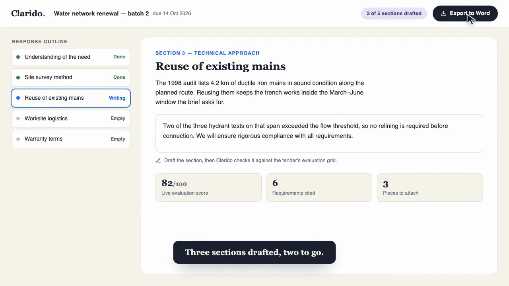
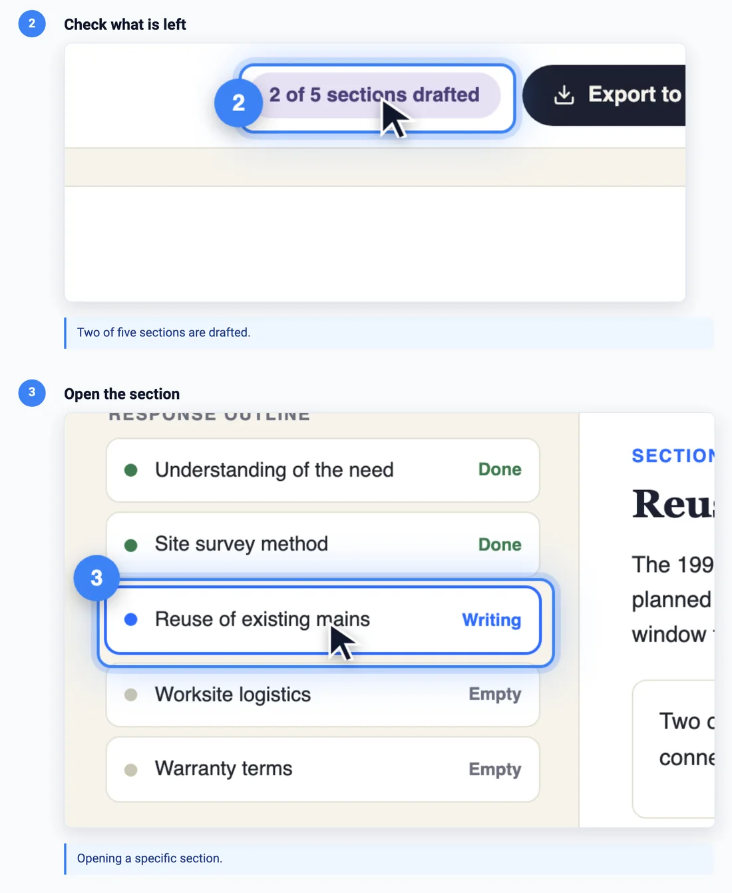

# Vistaro

**[vistaro.dev](https://vistaro.dev)**: the website, with the demos and a live tour of [every animation](https://vistaro.dev/animations.html).

A command-line tool for the AI coding agents that run on your machine: Claude Code, Codex, Antigravity. Ask your agent for a demo video, a help article or a marketing clip of your web app. The agent writes two text files, a mockup of the screen and a timeline of what happens on it, and the CLI turns them into the video and the guide. When the interface changes, you run it again. **Agents: start with [AGENTS.md](AGENTS.md), the manual with every file format.**

Under the hood, the CLI drives a headless browser through the timeline. It moves a cursor, clicks, types and zooms, and records what it sees. You get an MP4 with subtitles and chapters, a numbered guide with a screenshot for every step, and the same again in each language you add. None of this needs an API key.

**In:** the two files of the sample in [`demo/`](demo/). [`index.html`](demo/index.html) is the screen and [`anim.config.json`](demo/anim.config.json) is the timeline.

**Out:** a 21-second MP4 with subtitles and chapters ([watch it on vistaro.dev](https://vistaro.dev/#out-video)),

[](https://vistaro.dev/#out-video)

and a guide with one numbered frame per step, cropped to whatever the reader has to click:



Both come out of one command: `npx vistaro export demo -o demo.mp4 --guide` (see [Quick start](#quick-start)).

## Why not just record your screen

Because the recording is out of date the day the product changes. Then you record it again by hand, in one language, and nobody can review what changed. Here a demo is two text files in your repository, so:

- The UI moved? Run the command again. `build-all --changed-only` rebuilds only what changed and tells you which guides' screenshots drifted.
- The video and the written guide come from the same timeline, so they can't disagree.
- A new language is a translated strings file. The clicks, timings and camera moves are shared.
- The timeline is JSON, so it goes through a pull request like any other change, and the whole pipeline runs headless in CI.
- Marketing clips work the same way. A homepage animation is a timeline that gets reviewed and regenerated, not a video file someone re-cuts by hand. It usually gets its own mockup, since a marketing shot frames the product to make a point while a guide follows the real screens, but it uses the same tool, the same actions and the same translation path.

## What you get

- **Video**: an MP4 (or GIF) with a moving cursor, a spotlight and a click ripple on every interaction, plus typing, camera pushes and screen transitions. Subtitles are drawn on the frame at about 4% of its height and move out of the way of the cursor and whatever is highlighted on their own (`meta.subtitleScale` resizes them, a step's `subtitlePlace` pins one). You also get a `.vtt` file, MP4 chapters per step and, optionally, narration (OpenAI TTS or macOS `say`).
- **Step guide**: `guide.json`, `guide.md` and `guide.html`, with a numbered frame and a crop per step, the video inline, and the measured timings.
- **Languages**: `localize` scaffolds `locales/<code>/` with a `strings.<code>.json`. Only the text changes between languages.
- **Batch builds**: `help.catalog.json` plus `build-all` builds every guide in every language into one output tree with an `index.json`, skipping what hasn't changed and flagging guides whose frames drifted.
- **Live pages**: `record` drives your real app from the same timeline, with real navigation, waits for async loads, and a saved login.
- **Marketing reels**: set `"kind": "reel"` in the timeline. The spotlight, ripple and subtitles switch off, the clip is silent, and `export` gives you an MP4, a WebM, a poster and a GIF. If you turn subtitles back on (`"reel": { "subtitles": true }`), they render as a solid caption bar that stays readable in a muted autoplay clip. `build --embed` writes a self-contained `embed-<device>.html` that starts playing when scrolled into view and loops, plus the snippet for the page that hosts it. One responsive mockup covers desktop and phone, with per-device overrides in the timeline.

A step in the generated `guide.md` looks like this:

```markdown
## 2. Check what is left


> Two of five sections are drafted.
```

## Setup

In your project:

```bash
npm install --save-dev vistaro
npx playwright install chromium      # one time: the browser Vistaro records with
npx vistaro --help
```

Or once for the whole machine with `npm install -g vistaro` (then `vistaro --help`), or without installing anything with `npx vistaro@latest <command>`. Run the Chromium line in every case: npm 12 and pnpm skip install scripts by default, so the download usually does not happen on its own. If it is missing, the CLI stops and prints the command to run.

Node >= 20.6, macOS or Linux (Windows is untested). The manual is installed with the package at `node_modules/vistaro/AGENTS.md`. Optional keys in `.env` or the environment: `OPENAI_API_KEY` (narration; falls back to macOS `say`), `GEMINI_API_KEY` / `ANTHROPIC_API_KEY` (only for the standalone `extract` and `animate` commands).

From source, to contribute or to run unreleased code:

```bash
git clone https://github.com/clarido/Vistaro.git
cd Vistaro
npm install
npx playwright install chromium
```

In a clone, every `npx vistaro` in this README is `npx tsx cli.ts`, which is also the form the generated [CLI reference](#cli-reference) and the CLI's own hints print.

## Quick start

Run the sample in [`demo/`](demo/). It lives in the repository, not in the npm package: copy its `index.html` and `anim.config.json` into a `demo` folder in your project, or run these from a clone.

```bash
npx vistaro check demo                # schema, timing, and every target in a headless browser
npx vistaro build demo                # demo/animated.html: a self-playing page to open in a browser
npx vistaro preview demo              # demo/preview.png: one labelled frame per step
npx vistaro export demo -o demo.mp4 --guide
```

`export` writes `demo.mp4`, `demo.vtt`, the chapters and `demo/guide/` (`guide.json`, `guide.md`, `guide.html`, `assets/step-NN.png`). The video is as long as the timeline. Add `--narration` for a spoken track (`OPENAI_API_KEY`, or macOS `say`). `animated.html` is a generated file, so run `build` again after you edit `index.html`. `export` doesn't use it: it records `index.html` directly, which keeps the video identical to what `check` and `preview` saw.

For your own screen, put its `index.html` in a new folder, run `npx vistaro init-config <folder>` to scaffold a timeline next to it, then run the same commands on that folder.

A timeline is a list of timed interactions on CSS selectors:

```json
{
  "meta": { "title": "Create your first report", "cursor": "mac" },
  "steps": [
    { "id": "intro", "time": "0s", "action": "fadeIn", "target": "body", "title": "Overview", "subtitle": "Welcome to the dashboard." },
    { "id": "open",  "time": "2s", "action": "click", "target": ".btn-primary", "title": "Open the report builder", "narration": "Click the primary button." },
    { "id": "zoom",  "time": "4s", "action": "camera", "target": ".btn-primary", "scale": 1.3, "duration": 2 }
  ]
}
```

### With an AI agent

Paste your screenshots into the agent's chat and ask for the demo:

> *"Here are the three screens of our onboarding. Recreate them, write a timeline that walks through signing up, and export the video with a guide, in English and French."*

The agent writes `index.html` and `anim.config.json`, runs `check`, `build` and `preview`, looks at the preview PNG and fixes the timeline, exports with `--guide`, then runs `localize` and exports each language.

An agent can't watch a video, so everything about motion is also reported as text. `check` describes where each `camera` step lands: the visible window, what's in frame and what the frame edge cuts off. A zoom aimed at the wrong element shows up as a finding the agent can read and fix. `preview --motion` puts frames from a real playback on one sheet, `check --trace` logs where the cursor, spotlight, subtitle and camera were at every step, and `filmstrip` turns the exported MP4 into a labelled grid of frames, with an optional JSON report of what moved and when. The full workflow and every file format are in [AGENTS.md](AGENTS.md).

### Other languages

```bash
npx vistaro localize ./demo fr        # ./demo/locales/fr/ + strings.fr.json, pre-filled
# translate strings.fr.json and the visible text of locales/fr/index.html
npx vistaro export ./demo/locales/fr -o demo-fr.mp4 --guide
```

### A whole help site

```bash
npx vistaro build-all                 # every guide x locale of help.catalog.json -> help-out/
npx vistaro build-all --changed-only --diff
npx vistaro build-all --help          # catalog schema
```

### A live app instead of a mockup

```bash
npx playwright codegen --save-storage auth.json https://app.local/login   # sign in once
npx vistaro record ./guides/save --url https://app.local/save --storage-state auth.json -o save.mp4 --guide
```

### Standalone, with an LLM API key

```bash
npx vistaro extract screenshot.png ./demo --provider gemini      # screenshot -> index.html
npx vistaro animate ./demo "Fade in, then click the primary button" --provider claude
npx vistaro export ./demo -o demo.mp4
```

## Tech

Node.js + TypeScript through `tsx` (no build step), `commander`, Playwright Chromium, `ffmpeg-static` (libx264 crf 18, VP9 for WebM), `pixelmatch` for the staleness diff. Desktop exports record at 1920x1080, mobile at 390x844; `--width`/`--height` override.

The video is exactly as many pixels as the CSS viewport. Playwright's screencast paints one CSS pixel per video pixel and ignores `deviceScaleFactor`, so the only way to get more pixels is a bigger viewport. `--scale N` multiplies the viewport and zooms the page back with `:root { zoom: N }`: at `--scale 2` a phone clip is 780x1688 while its layout is still 390x844. Guide screenshots aren't affected and stay at 2x.

Contributing: `npm test` runs the suite (serial, with browser tests; `SKIP_BROWSER=1` to skip them); `npm run docs` regenerates the CLI reference below from `cli.ts`, and `npm run docs:check` fails when it is stale.

## CLI reference

<!-- cli-reference:start -->
Generated from `cli.ts` by `npm run docs`; do not edit by hand. `npx tsx cli.ts <command> --help` prints the same, plus the usage guide (`--help`) and the catalog schema (`build-all --help`).

[`init-config`](#init-config) · [`extract`](#extract) · [`animate`](#animate) · [`build`](#build) · [`check`](#check) · [`preview`](#preview) · [`export`](#export) · [`record`](#record) · [`guide`](#guide) · [`filmstrip`](#filmstrip) · [`verify`](#verify) · [`studio`](#studio) · [`demos`](#demos) · [`build-all`](#build-all) · [`tour`](#tour) · [`localize`](#localize)

### `init-config`

```bash
npx tsx cli.ts init-config <output_dir> [options]
```

Scaffold an anim.config.json timeline file in the target directory

| Argument | Description |
|---|---|
| `<output_dir>` | Directory to initialize the config in |

| Option | Description |
|---|---|
| `--kind <profile>` | Which profile to scaffold: guide (default) or reel (silent looping product clip) |
| `--force` | Overwrite an existing anim.config.json |

### `extract`

```bash
npx tsx cli.ts extract <image_path> <output_dir> [options]
```

Extract an HTML/CSS essence from a screenshot (needs an LLM API key)

| Argument | Description |
|---|---|
| `<image_path>` | Path to the screenshot image |
| `<output_dir>` | Directory to save the generated HTML essence |

| Option | Description |
|---|---|
| `-p, --provider <provider>` | LLM provider (gemini or claude) (default: `gemini`) |
| `-m, --model <model>` | LLM model ID (e.g. gemini-2.5-flash, claude-haiku-4-5-20251001). Defaults per provider |
| `-a, --abstraction <level>` | Abstraction distillation level: none, moderate, high (default: `none`) |
| `--device <type>` | Device viewport constraints: desktop or mobile (default: `desktop`) |
| `-f, --framework <type>` | Output framework: html or react (default: `html`) |
| `-t, --theme <mode>` | Color scheme mode: light or dark (default: `light`) |

### `animate`

```bash
npx tsx cli.ts animate <output_dir> <prompt> [options]
```

Write anim.config.json + animated.html from a prompt (needs an LLM API key; agents write the timeline themselves and run build)

| Argument | Description |
|---|---|
| `<output_dir>` | Directory containing the generated HTML essence |
| `<prompt>` | Prompt describing the desired animation |

| Option | Description |
|---|---|
| `-p, --provider <provider>` | LLM provider (gemini or claude) (default: `gemini`) |
| `-m, --model <model>` | LLM model ID (e.g. gemini-2.5-flash, claude-haiku-4-5-20251001). Defaults per provider |
| `-c, --cursor <style>` | Cursor style: mac, windows, none (default: `mac`) |
| `-l, --loop` | Loop the generated HTML animation endlessly |
| `--locale <code>` | Locale code for this output (e.g. en, fr) -- recorded in anim.manifest.json |

### `build`

```bash
npx tsx cli.ts build <output_dir> [options]
```

Build animated.html from index.html + anim.config.json (no LLM, no API key)

| Argument | Description |
|---|---|
| `<output_dir>` | Directory containing index.html and anim.config.json |

| Option | Description |
|---|---|
| `-c, --cursor <style>` | Cursor style: mac, windows, none (default: meta.cursor or mac) |
| `--device <type>` | Which device's timeline to bake in (resolves "only"/"mobile"/"desktop" steps): desktop or mobile (default: `desktop`) |
| `--embed` | Also write embed-<device>.html (a framable, self-contained clip) and embed-<device>.snippet.html (the parent-side iframe snippet) |
| `-l, --loop` | Loop the animation endlessly when opened in a browser |
| `--config <file>` | Use a timeline other than <dir>/anim.config.json (one screen, several scenarios); path is relative to the current directory |
| `--locale <code>` | Locale code for this output (e.g. en, fr) -- recorded in anim.manifest.json |
| `--force` | Build even if the timeline has validation errors |
| `-o, --output <file>` | Write the built HTML somewhere other than <output_dir>/animated.html |

### `check`

```bash
npx tsx cli.ts check <output_dir> [options]
```

Validate anim.config.json: schema, timing, strings, and (unless --static/--live) every target selector in a headless browser; each camera step also reports its framing as facts (window, what is in frame, what is cut)

| Argument | Description |
|---|---|
| `<output_dir>` | Directory containing anim.config.json (and index.html unless --live) |

| Option | Description |
|---|---|
| `--static` | Schema and timing checks only, no browser |
| `--scale <n>` | Pixel density used for the recording: the viewport is multiplied by N and the page zoomed back, so media queries see the scaled width |
| `--live` | Validate a timeline meant for `record` (live page): navigate/waitFor allowed, no index.html needed; add --url to also probe every target against the page |
| `--url <url>` | With --live: probe every target against this page. The timeline is replayed for real (clicks, keystrokes and saves happen), so reset the app first when it writes data |
| `--storage-state <file>` | Live probe: Playwright storage state (cookies/localStorage) |
| `--ignore-https-errors` | Live probe: accept self-signed certificates |
| `--reset-cmd <command>` | Live probe: shell command run before the pass |
| `--allow-reset` | Let "meta.reset" from anim.config.json run (a shell command out of a file; --reset-cmd never needs this) |
| `--guide` | Validate as a guide: a numbered step without a "title" is an error, not a warning |
| `--config <file>` | Use a timeline other than <dir>/anim.config.json (one screen, several scenarios); path is relative to the current directory |
| `--trace` | Record per-step overlay geometry (cursor, spotlight, subtitle chip, camera window) to <dir>/trace.json during the browser pass |
| `--json` | Print the issues as JSON on stdout |
| `--locale <code>` | Locale code (e.g. en, fr) |
| `-w, --width <pixels>` | Viewport width for the browser pass |
| `-H, --height <pixels>` | Viewport height for the browser pass |
| `--device <type>` | Device viewport constraints: desktop or mobile (default: `desktop`) |
| `-t, --theme <mode>` | Color scheme mode: light or dark (default: `light`) |

### `preview`

```bash
npx tsx cli.ts preview <output_dir> [options]
```

Render one labelled frame per step to <output_dir>/preview.png (or a single full-size frame with --step N)

| Argument | Description |
|---|---|
| `<output_dir>` | Directory containing index.html and anim.config.json |

| Option | Description |
|---|---|
| `-s, --step <n>` | Write only step N (1-based) at full resolution to preview-step-N.png |
| `--motion` | Sample a real playback pass into preview-motion.png instead: mid-travel framing, cursor glide and typing as they actually play |
| `--config <file>` | Use a timeline other than <dir>/anim.config.json (one screen, several scenarios); path is relative to the current directory |
| `--scale <n>` | Pixel density used for the recording: the viewport is multiplied by N and the page zoomed back, so media queries see the scaled width |
| `--at <when>` | Capture point per step: "auto" (like the guide: clicks at the interaction, typing/camera/fades at completion), "interaction", or "end" (default: `auto`) |
| `-o, --output <file>` | Output PNG path |
| `-c, --cursor <style>` | Cursor style: mac, windows, none (default: meta.cursor or mac) |
| `--locale <code>` | Locale code (e.g. en, fr) |
| `--force` | Preview even if the timeline has validation errors |
| `-w, --width <pixels>` | Viewport width in pixels |
| `-H, --height <pixels>` | Viewport height in pixels |
| `--device <type>` | Device viewport constraints: desktop or mobile (default: `desktop`) |
| `-t, --theme <mode>` | Color scheme mode: light or dark (default: `light`) |

### `export`

```bash
npx tsx cli.ts export <output_dir> [options]
```

Record the timeline to an MP4/GIF (plus .vtt subtitles, chapters, optional narration and step guide); the length comes from the timeline

| Argument | Description |
|---|---|
| `<output_dir>` | Directory containing index.html + anim.config.json (or a legacy animated.html) |

| Option | Description |
|---|---|
| `-d, --duration <seconds>` | Override the export length in seconds (a bare number, e.g. 12 or 12.5; default: computed from the timeline; 5 without a config) |
| `-o, --output <file>` | Output video file path (.mp4 or .gif) (default: `output.mp4`) |
| `-w, --width <pixels>` | Width of the exported video in pixels |
| `-H, --height <pixels>` | Height of the exported video in pixels |
| `--device <type>` | Device viewport constraints: desktop or mobile (default: `desktop`) |
| `--scale <n>` | Pixel density: multiply the viewport by N and zoom the page back, so the frame is N times denser (media queries then see the scaled width) |
| `-t, --theme <mode>` | Color scheme mode for Playwright: light or dark (default: `light`) |
| `--narration` | Synthesize each step's "narration" (or "subtitle") and mix it in at the step's time (OPENAI_API_KEY or macOS say) |
| `--voice <name>` | TTS voice (OpenAI voice name, or a macOS `say` voice) |
| `-v, --voiceover <path>` | Path to a text file with a whole-video voiceover script (legacy, starts at 0s) |
| `--no-subtitles` | Do not write <output>.vtt |
| `--no-chapters` | Do not embed MP4 chapters for titled steps |
| `--clips <format>` | Also cut one clip per step next to the video: mp4 or gif |
| `--tail <ms>` | Hold after the last step, in ms -- bare (2500) or unit-suffixed ("2.5s"); overrides meta.tailMs, default 2500 |
| `--config <file>` | Use a timeline other than <dir>/anim.config.json (one screen, several scenarios); path is relative to the current directory |
| `--guide` | Also write the step-by-step guide (guide.json, guide.md, guide.html, assets/) after the video |
| `--guide-dir <dir>` | Guide output directory (default: <output_dir>/guide) |
| `--crop <px>` | Guide crops: padding around each step's box in px (default 120) |
| `--no-crop` | Guide: full frames only, no crops |
| `--hide-cursor` | Guide: hide the fake cursor in the step screenshots |
| `--force` | Export even if the timeline has validation errors; step failures then do not fail the command |
| `--locale <code>` | Locale code for this output (e.g. en, fr) -- recorded in anim.manifest.json |

### `record`

```bash
npx tsx cli.ts record <output_dir> [options]
```

Record the timeline against a live page (URL) instead of a local mockup: real navigations, waitFor, storage state

| Argument | Description |
|---|---|
| `<output_dir>` | Directory containing anim.config.json (targets are selectors in the live app, e.g. [data-help="save"]) |

| Option | Description |
|---|---|
| `--url <url>` | Page to open (default: meta.url in anim.config.json) |
| `--storage-state <file>` | Playwright storage state (cookies/localStorage), e.g. from `npx playwright codegen --save-storage auth.json` |
| `--ignore-https-errors` | Accept self-signed certificates (mkcert-style local HTTPS) |
| `--reset-cmd <command>` | Shell command run before each pass over the app (the recording, then the --guide replay); used instead of meta.reset, and never needs --allow-reset |
| `--allow-reset` | Let "meta.reset" from anim.config.json run (a shell command out of a file; --reset-cmd never needs this) |
| `--fail-fast` | Abandon the recording at the first waitFor timeout instead of recording the rest against the wrong page state |
| `-o, --output <file>` | Output video file path (.mp4 or .gif) (default: `output.mp4`) |
| `-d, --duration <seconds>` | Override the recording length in seconds (a bare number, e.g. 12 or 12.5; default: computed from the timeline) |
| `-w, --width <pixels>` | Width of the recorded video in pixels |
| `-H, --height <pixels>` | Height of the recorded video in pixels |
| `--device <type>` | Device viewport constraints: desktop or mobile (default: `desktop`) |
| `-t, --theme <mode>` | Color scheme mode: light or dark (default: `light`) |
| `--narration` | Synthesize each step's narration and mix it in |
| `--voice <name>` | TTS voice |
| `--no-subtitles` | Do not write <output>.vtt |
| `--no-chapters` | Do not embed MP4 chapters |
| `--clips <format>` | Also cut one clip per step: mp4 or gif |
| `--tail <ms>` | Hold after the last step, in ms -- bare (2500) or unit-suffixed ("2.5s"); overrides meta.tailMs |
| `--config <file>` | Use a timeline other than <dir>/anim.config.json (one screen, several scenarios); path is relative to the current directory |
| `--guide` | Also capture the step guide against the live page (re-navigates, replays in step mode) |
| `--guide-dir <dir>` | Guide output directory (default: <output_dir>/guide) |
| `--crop <px>` | Guide crops: padding around each step's box in px (default 120) |
| `--no-crop` | Guide: full frames only |
| `--hide-cursor` | Guide: hide the fake cursor in step screenshots |
| `--force` | Record even if the timeline has validation errors; step failures then do not fail the command |
| `--locale <code>` | Locale code for this output (e.g. en, fr) |
| `--learn <file>` | (experimental) Write the interactions the recording performed as a draft anim.config.json to <file> (plus <file>.notes.md): steps in observed order, ids step-01..., times in ms, targets re-resolved to the stablest selector (data-help > #id > tag.class > :nth-of-type); no titles -- add them before building a guide; exits 1 when nothing was captured |

### `guide`

```bash
npx tsx cli.ts guide <output_dir> [options]
```

Write a Scribe-style step guide (guide.json, guide.md, guide.html + assets/) from index.html + anim.config.json; links the last exported video when present

| Argument | Description |
|---|---|
| `<output_dir>` | Directory containing index.html and anim.config.json |

| Option | Description |
|---|---|
| `-o, --output <dir>` | Guide output directory (default: <output_dir>/guide) |
| `--crop <px>` | Padding around each step's box for the cropped image, in px (default 120) |
| `--no-crop` | Full frames only, no crops |
| `--clips <format>` | Cut one clip per step from the last exported video: mp4 or gif |
| `--hide-cursor` | Hide the fake cursor in the step screenshots |
| `--no-marks` | Do not burn the spotlight ring and numbered badge into the frames (rect/callout are still recorded) |
| `--config <file>` | Use a timeline other than <dir>/anim.config.json (one screen, several scenarios); path is relative to the current directory |
| `--url <url>` | After a `record`: replay against this URL instead of the one in the manifest |
| `--storage-state <file>` | After a `record`: storage state for the live replay (default: the one the record used) |
| `--ignore-https-errors` | Accept self-signed certificates on the live replay |
| `--reset-cmd <command>` | After a `record`: shell command run before the live replay |
| `--allow-reset` | Let "meta.reset" from anim.config.json run (a shell command out of a file; --reset-cmd never needs this) |
| `--locale <code>` | Locale code (e.g. en, fr) |
| `--force` | Capture even if the timeline has validation errors; step failures then do not fail the command |
| `-w, --width <pixels>` | Viewport width in pixels |
| `-H, --height <pixels>` | Viewport height in pixels |
| `--device <type>` | Device viewport constraints: desktop or mobile (default: `desktop`) |
| `-t, --theme <mode>` | Color scheme mode: light or dark (default: `light`) |

### `filmstrip`

```bash
npx tsx cli.ts filmstrip <video> [options]
```

Turn an exported video into one labelled contact strip (and optional --diff motion facts): review the clip without watching it

| Argument | Description |
|---|---|
| `<video>` | Video file to sample (e.g. demo.mp4) |

| Option | Description |
|---|---|
| `-o, --output <file>` | Output strip PNG path (default: <video>.strip.png beside it) |
| `--fps <n>` | Samples per second to extract (default: 2, lowered automatically when the video is long) |
| `--columns <n>` | Tiles per row in the strip (default: 6) |
| `--cell-width <px>` | Tile width in px (default: 480) |
| `--max-tiles <n>` | Upper bound on tiles before the sample rate drops (default: 48) |
| `--diff <file>` | Also write pairwise frame-diff motion facts as JSON: what moved, when, where |

### `verify`

```bash
npx tsx cli.ts verify <output_dir> [options]
```

Build and audit a demo in one command: run the export pipeline (verify.mp4 + verify.vtt beside it), then the filmstrip pass (verify.strip.png), and write verify.json (ok, durationMs, steps, chapters, issues); exit 1 when any step failed

| Argument | Description |
|---|---|
| `<output_dir>` | Directory containing index.html and anim.config.json |

| Option | Description |
|---|---|
| `-w, --width <pixels>` | Viewport width in pixels |
| `-H, --height <pixels>` | Viewport height in pixels |
| `--device <type>` | Device viewport constraints: desktop or mobile (default: `desktop`) |
| `--scale <n>` | Pixel density for the recording: the viewport is multiplied by N and the page zoomed back, so media queries see the scaled width |
| `-t, --theme <mode>` | Color scheme mode for Playwright: light or dark (default: `light`) |
| `--locale <code>` | Locale code (e.g. en, fr) |
| `--config <file>` | Use a timeline other than <dir>/anim.config.json (one screen, several scenarios); path is relative to the current directory |

### `studio`

```bash
npx tsx cli.ts studio [output_dir] [options]
```

Open a local web editor over the timeline: with no directory it serves the project picker (every demo in the workspace, recents first); with one it opens that screen directly. Edit steps with a seekable live preview, pick targets by clicking, apply effect presets, retime steps by dragging them on the timeline ruler, run check/export, and save anim.config.json (the editor is a view over the file, never a second source of truth). Running the CLI with no command at all boots the same server on the hub page (/hub: the ask for your agent, the manual at /agents.md) and opens your browser

| Argument | Description |
|---|---|
| `[output_dir]` | Directory containing index.html (the screen to edit a timeline for); omit it for the project picker |

| Option | Description |
|---|---|
| `-p, --port <n>` | Port to serve the editor on (default: an ephemeral one, printed on start) |
| `-w, --width <pixels>` | Authored viewport width of the preview iframe (default: 1280) |
| `-H, --height <pixels>` | Authored viewport height of the preview iframe (default: 720) |
| `--config <file>` | Edit a timeline other than <dir>/anim.config.json (one screen, several scenarios); path is relative to the current directory |
| `--device <type>` | Initial preview device: desktop or mobile (mobile also frames the preview at 390x844) |

### `demos`

```bash
npx tsx cli.ts demos [options]
```

List every demo project in the workspace (screens, scenario stories, catalog entries), newest first, with the studio command that opens each -- the terminal twin of the picker

| Option | Description |
|---|---|
| `--json` | Print the scanner output as JSON (for agents and scripts) |

### `build-all`

```bash
npx tsx cli.ts build-all [catalog] [options]
```

Build every guide x locale of help.catalog.json (check, build, export|record --guide) into <outputDir>/<slug>/<locale>/ and merge index.json + index.md; exit 1 on any failure

| Argument | Description |
|---|---|
| `[catalog]` | Catalog file (default: `help.catalog.json`) |

| Option | Description |
|---|---|
| `--changed-only` | Skip a guide x locale whose build key (sources + render settings + tool version) matches what its manifest recorded |
| `--diff` | Keep the previous step frames and mark a guide stale when a frame changed beyond --diff-threshold |
| `--diff-threshold <fraction>` | Fraction of changed pixels that marks a guide stale (default: `0.02`) |
| `--only <slug>` | Build one guide |
| `--locale <code>` | Build one locale |
| `--continue-on-error` | Keep going after a failed guide (default: stop at the first failure) |
| `--dry-run` | Print the plan per guide x locale and stop: nothing is created, written or recorded |
| `--verbose` | Also stream the child commands' stdout (their stderr is always streamed, prefixed with slug/locale) |
| `--allow-reset` | Let each guide's "meta.reset" run before its passes (a shell command out of its anim.config.json) |

### `tour`

```bash
npx tsx cli.ts tour [catalog] [options]
```

Build an interactive tour site from tour.catalog.json: a scenario rail plus a canvas that plays any scenario step by step (no capture, no encoding)

| Argument | Description |
|---|---|
| `[catalog]` | Catalog file (default: `tour.catalog.json`) |

| Option | Description |
|---|---|
| `-o, --output <dir>` | Directory to write the tour into (default: the catalog's outputDir, else tour-out) |
| `--force` | Build scenarios that have validation errors |
| `--embed` | Also write embed-<slug>-<device>.html per scenario, the <anim-tour> custom element and a no-module snippet fallback |
| `--embed-origin <origin>` | targetOrigin the embed pages use to report to the page that frames them (default: any) |

### `localize`

```bash
npx tsx cli.ts localize <source_dir> <locale> [options]
```

Scaffold <source_dir>/locales/<locale>/ with index.html, anim.config.json, media and a pre-filled strings.<locale>.json; the choreography is reused as is

| Argument | Description |
|---|---|
| `<source_dir>` | Existing output directory to localize from (contains index.html, optionally anim.config.json) |
| `<locale>` | Target locale code, e.g. fr, es, pt-BR |

| Option | Description |
|---|---|
| `-o, --output-dir <dir>` | Directory to scaffold into (default: <source_dir>/locales/<locale>) |
| `--sibling` | Legacy layout: scaffold into a sibling directory named after the locale |
| `--force` | Overwrite the target's index.html, anim.config.json and strings.<locale>.json (translations are lost); by default they are kept and only new strings are added |
<!-- cli-reference:end -->
